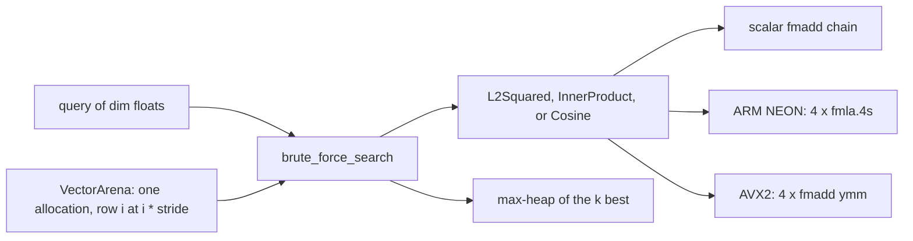

# bazavec

C++20 header-only vector search. Phase 1 is an exact engine: a 128-byte-aligned arena, scalar / ARM NEON / AVX2 distance kernels, and brute-force top-k. Later phases (HNSW, int8 quantization, hybrid filters, `mmap`) are not in this tree yet.

The core has no library dependencies. The public headers live under `include/bazavec/`.



## Layout

| Path | Role |
| --- | --- |
| `include/bazavec/detail/memory.hpp` | `std::aligned_alloc` arena block, freed with `free` |
| `include/bazavec/distance.hpp` | Scalar baseline plus NEON and AVX2 kernels |
| `include/bazavec/storage.hpp` | `VectorArena`, stride padded to 128 bytes |
| `include/bazavec/brute_force.hpp` | Exact top-k |
| `tests/test_phase1.cpp` | Kernel identity, alignment, heap order |
| `bench/bench_phase1.cpp` | Throughput and top-10 latency |

`stride` is `dim` rounded up to 32 floats. Row `i` is `data + i * stride`, so every row starts on a cache line and a 128-wide row has no scalar tail.

## Build

Release is the configuration the benchmark measures. On arm64 that is `-O3 -mcpu=native`. On x86_64 it is `-O3 -march=native -mavx2 -mfma`. `-ffast-math` is intentionally off.

```bash
cmake -S . -B build/release -DCMAKE_BUILD_TYPE=Release -G Ninja
cmake --build build/release -j
./build/release/bazavec_tests
./build/release/bench_bazavec
```

Debug turns on UBSan with `-fno-sanitize-recover=undefined`, so a failed check aborts the process:

```bash
cmake -S . -B build/debug -DCMAKE_BUILD_TYPE=Debug -G Ninja
cmake --build build/debug -j
./build/debug/bazavec_tests
```

AddressSanitizer is the other half of the Debug preset (`-fsanitize=address,undefined`), enabled with `-DBAZAVEC_ENABLE_ASAN=ON`. AppleClang 17's ASan runtime on macOS 27 deadlocks before `main`: `AsanInitFromRtl` allocates while its init spinlock is held. An empty `main` reproduces it, so the hang is the runtime. UBSan is what Debug runs here until that runtime is fixed.

## What the kernels guarantee

`L2Squared` returns squared Euclidean distance. Ranking uses the square because square root is strictly increasing on `[0, ∞)`, so it cannot change which neighbor wins.

`InnerProduct` and `Cosine` return similarity. Larger is better. A zero vector has cosine 0. The dot product is not marked `__restrict`, because the cosine norm dots a pointer with itself.

Scalar and SIMD disagree only by reduction order. On the benchmark set the largest absolute gap was `7.6e-5` for L2 and `6.7e-6` for inner product, over 100,000 distances of dimension 128.

## Benchmark

Recorded on a MacBook Air, Apple M4 (4 performance cores, 6 efficiency cores, 16 GB), AppleClang 17, Release flags above. The bench thread sets `QOS_CLASS_USER_INTERACTIVE`. One run; a second run sat within a few percent.

The working set is 100,000 vectors of dimension 128: 51,200,000 bytes (48.83 MiB). That is larger than the 16 MiB performance-cluster L2 (`hw.perflevel0.l2cachesize`). The cache line on this machine is 128 bytes (`hw.cachelinesize`). GB/s counts database reads only. The query stays in L1 and is not included. 1 GB = 1e9 bytes.

| Metric | Kernel | ns/vector | GB/s |
| --- | ---: | ---: | ---: |
| L2Squared | scalar | 64.85 | 7.90 |
| L2Squared | clang autovec | 29.72 | 17.23 |
| L2Squared | ARM NEON | 7.66 | 66.88 |
| InnerProduct | scalar | 62.98 | 8.13 |
| InnerProduct | clang autovec | 26.76 | 19.13 |
| InnerProduct | ARM NEON | 7.82 | 65.43 |

NEON against the scalar baseline: **8.47x** on L2, **8.05x** on inner product. NEON against clang's auto-vectorized loop: **3.88x** and **3.42x**.

The scalar loop is one `fmadd` on `s1`, and `s1` is both an input and the destination, so the next element waits on that chain. Clang's auto-vectorizer does emit `fsub.4s` / `fmul.4s`, then extracts every lane and adds it into one scalar register before the next 16 floats. The hand-written kernel keeps four `fmla.4s` accumulators (`v1`–`v4`) for the whole row and horizontal-adds once. `llvm-objdump` of `bazavec_scan_l2_scalar`, `bazavec_scan_l2_autovec`, and `bazavec_scan_l2_simd` in the Release bench is the check.

Brute-force top-10 over the same 100,000 vectors, 80 queries, microseconds:

| Kernel | mean | p50 | p99 |
| --- | ---: | ---: | ---: |
| scalar | 6746 | 6731 | 7063 |
| ARM NEON | 813 | 782 | 1154 |

That is an **8.30x** end-to-end speedup. The NEON top-1 id matches a linear argmin.

## Tests

`bazavec_tests` is 570 checks: padded stride, 128-byte row alignment, zero padding, bit-exact distances on values that are dyadic rationals, a double-precision reference on random data, tie-break by smaller id, and brute-force order against a full sort for L2, inner product, and cosine. Release and Debug/UBSan both pass. The AVX2 kernels were syntax-checked with `-target x86_64-apple-macos14 -mavx2 -mfma`.

## Roadmap

1. **Done.** Arena, distance kernels, exact top-k.
2. Flattened HNSW: contiguous layer-0 adjacency, `__builtin_prefetch` on the random walk, parallel insert with per-node locks.
3. Symmetric int8 quantization and a bitmap predicate pushed into the graph walk. This Mac reports `hw.optional.arm.FEAT_DotProd = 1`.
4. A `.vdb` file and `mmap` load. The page size here is 16 KiB.
5. Recall@10 against the Phase 1 brute-force ground truth, a fuller bench, and an optional `pybind11` wrapper.
